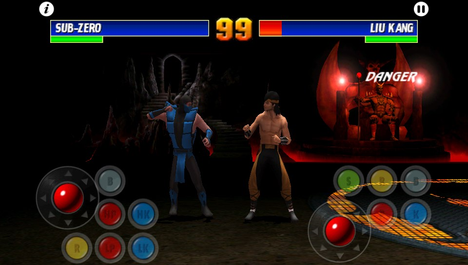
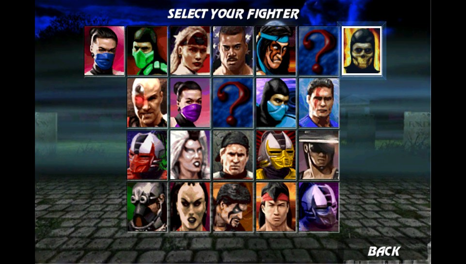

# Ultimate Mortal Kombat 3 — Port para PS Vita

**Un port nativo para PlayStation Vita de *Ultimate Mortal Kombat 3* para iOS, hecho a partir de la descompilación de la versión de iOS (v1.2.59).**

Basado en [MaryNCRT/Ultimate-Mortal-Kombat-3-iOS-Decompiled](https://github.com/MaryNCRT/Ultimate-Mortal-Kombat-3-iOS-Decompiled) · Gráficos con [vitaGL](https://github.com/Rinnegatamante/vitaGL) de Rinnegatamante · [README en inglés](README.md) · [Notas de Vita](vita/README_VITA.md)

---

## Port para PS Vita

Este repositorio parte de la **[descompilación de UMK3 para iOS y el port para PC de MaryNCRT](https://github.com/MaryNCRT/Ultimate-Mortal-Kombat-3-iOS-Decompiled)** (versión 0.1.11 beta) y le añade una capa para PlayStation Vita, que está en [`vita/`](vita/) y en el código marcado `UMK3_VITA`.

> [!IMPORTANT]
> **Aquí no hay datos del juego.** Necesitas tu propia copia legal de *Ultimate Mortal Kombat 3* para iOS (**v1.2.59**, `.ipa`). El VPK que compiles lleva datos de tu copia: no lo compartas.

  
  

Compilar: `python3 vita/apply_cmake_patch.py` y luego `./vita/build.sh ruta/al/UMK3_1.2.59.ipa`. Detalles, ajustes de `vita.cfg` y estado en [`vita/README_VITA.md`](vita/README_VITA.md) y en el [README en inglés](README.md).

**Controles:** Cuadrado / Triángulo / Cruz / Círculo = golpes (6 botones como el arcade: puño alto, patada alta, puño bajo, patada baja; 5 botones: Cuadrado o Triángulo = puño, Cruz o Círculo = patada), R = bloquear, L = correr, **panel táctil trasero (mitad de arriba) = botón especial (S) para lanzar los poderes**, Start = pausa, Select = lista de movimientos. Para cambiar entre 5 y 6 botones: en el juego, **OPTIONS → CONTROLS**, o `buttons=6` / `buttons=5` en `ux0:data/umk3/vita.cfg`.

**Créditos:** [MaryNCRT](https://github.com/MaryNCRT) por la descompilación y el port de PC en los que se basa este port (y los arreglos de kombos traídos de su versión 0.2.0 y 0.1.17); [Rinnegatamante](https://github.com/Rinnegatamante) por [vitaGL](https://github.com/Rinnegatamante/vitaGL); el proyecto [VitaSDK](https://vitasdk.org/) y sus paquetes (SDL2, SDL2_mixer). Port de Vita: gmejia11, con Claude de Anthropic (Claude Code). Del proyecto original: código de [Blender](https://www.blender.org) (`src/thirdparty/blender`, GPL); renders del banner por [ermaccer](https://github.com/ermaccer) ([CC BY 4.0](https://creativecommons.org/licenses/by/4.0/)); logotipo UHD por [u/JuananoLaGarza](https://www.reddit.com/r/MortalKombat/comments/mvm4uo/ultimate_mortal_kombat_3_logo_redone_in_uhd/); iconos de teclas y botones de [Free Input Prompts](https://juliocacko.itch.io/free-input-prompts) de Julio Cacko (CC0). Licencia GPL-2.0-or-later.

*Ultimate Mortal Kombat 3* fue creado por Midway Games y portado a iOS por EA Mobile. Este proyecto no está afiliado a Warner Bros. Entertainment ni a Electronic Arts y no distribuye código ni recursos con derechos de autor.
