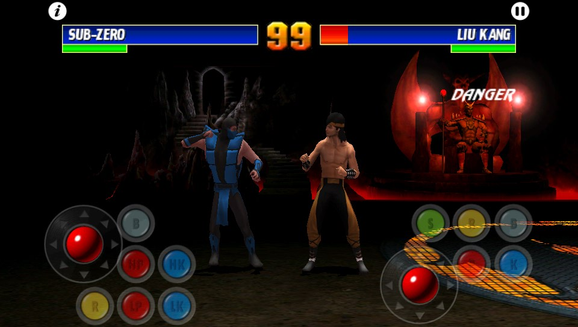
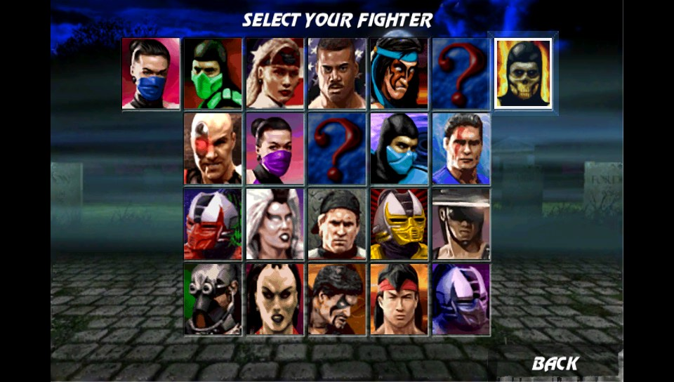
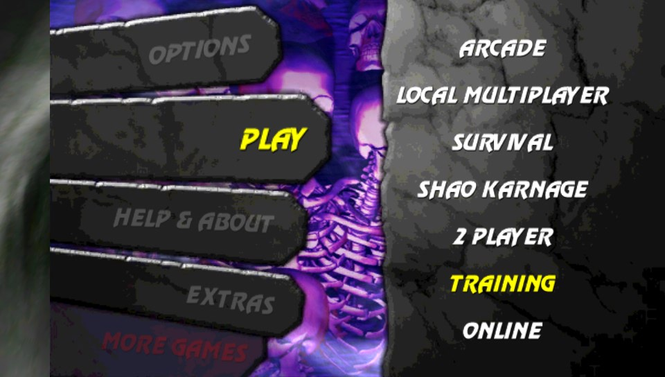
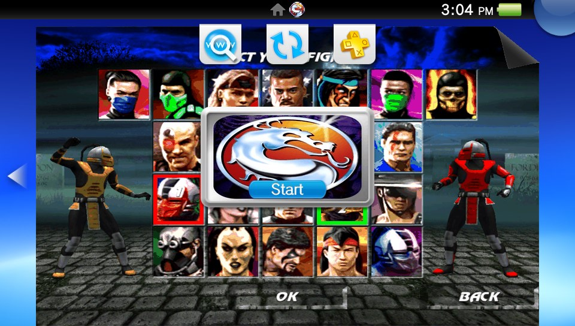
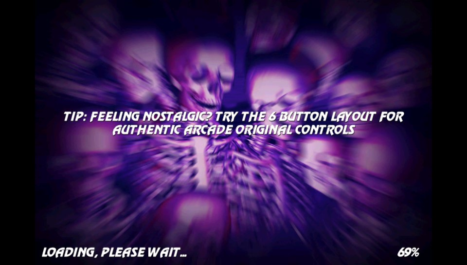

<div align="center">

# Ultimate Mortal Kombat 3 — PS Vita Port

**A native PlayStation Vita port of *Ultimate Mortal Kombat 3* for iOS, built from the decompilation of the iOS release (v1.2.59).**

Based on [MaryNCRT/Ultimate-Mortal-Kombat-3-iOS-Decompiled](https://github.com/MaryNCRT/Ultimate-Mortal-Kombat-3-iOS-Decompiled) · Rendered with [vitaGL](https://github.com/Rinnegatamante/vitaGL) by Rinnegatamante · [Vita build & settings](vita/README_VITA.md)

</div>

---

## PS Vita port

This repository is a fork of **[MaryNCRT's Ultimate Mortal Kombat 3 iOS decompilation and PC port](https://github.com/MaryNCRT/Ultimate-Mortal-Kombat-3-iOS-Decompiled)** (based on its v0.1.11 beta), with a PlayStation Vita platform layer added. The game code is the decompilation from that project; everything Vita-specific lives in [`vita/`](vita/) and in code marked `UMK3_VITA`.

> [!IMPORTANT]
> **No game data is distributed here — not in the repository, not in the VPK.** You need your own legally obtained copy of *Ultimate Mortal Kombat 3* for iOS (**v1.2.59**, `.ipa`); every game file, including the fight engine's tables, is made from it on your computer and copied to the Vita.

<p align="center">
  
  
  
  
  
</p>
<p align="center"><sub>Screenshots taken on a PS Vita.</sub></p>

### Status

- Plays on a real PS Vita (vitaGL, SDL2 audio). Fight loads use an asset pack (`umk3.pak`) built from your `.ipa`.
- Known: Classic Sub-Zero's arm kombo has missing poses — the iOS release's own frame lists lack them (`RPCOMBO6`–`RPCOMBO10`); the port borrows the four that exist elsewhere and holds the last pose for the fifth, which no fighter has.
- Changes from 2026-11-14 (batched blood drops, lighter log, kombo backports from upstream, the tables loaded from `umk3_tables.bin`) build cleanly and have been run on a Vita; the kombo options were tried (the default `kombo_slide=1` plays best). See [`docs/PROGRESS.md`](docs/PROGRESS.md).

### Installing

**Requirements on the Vita:** HENkaku / Ensō with **Enable Unsafe Homebrew** on (HENkaku settings), and **`libshacccg.suprx`** in `ur0:data/` or `ur0:data/external/` — vitaGL compiles its shaders with it; extract it with [ShaRKBR33D](https://github.com/Rinnegatamante/ShaRKBR33D). kubridge is not needed.

1. **The VPK:** install `UMK3-Vita.vpk` (from [Releases](https://github.com/gmejia11/UMK3-Vita/releases), or one you built) with VitaShell. It holds the port's code and its icon and LiveArea images, and none of the game's data.
2. **The game's data, from your `.ipa`:** on a PC with Python 3, with this repository at the same version as the VPK:
   ```bash
   python3 vita/make_data.py path/to/UMK3_1.2.59.ipa
   # -> vita/data/: res/, frames.x, moves_data.x, umk3.pak, umk3_tables.bin
   ```
3. **Copy `vita/data/` to `ux0:data/umk3/`** on the Vita — VitaShell's FTP (press SELECT), or `./vita/deploy_data.sh <VITA_IP> --all`.

`umk3_tables.bin` holds the fight engine's tables, read from the game's binary; the VPK loads it at start-up and says so on screen if it is missing or was made for another version. Settings are in `ux0:data/umk3/vita.cfg`; see [`vita/README_VITA.md`](vita/README_VITA.md).

### Building the VPK (Linux / WSL)

Requires [VitaSDK](https://vitasdk.org/) with vitaGL, SDL2 and SDL2_mixer (`vdpm`), Python 3 and, optionally, Pillow (for the icon).

```bash
./vita/build.sh path/to/UMK3_1.2.59.ipa            # icon from your .ipa, for yourself
./vita/build.sh path/to/UMK3_1.2.59.ipa --public   # generic icon, a VPK you can share
# -> build-vita/umk3.vpk, and vita/data/ with the game's files, umk3.pak and umk3_tables.bin
```

The build needs your `.ipa` to know the tables' names and sizes, but compiles them empty: their values go to `umk3_tables.bin` (`vita/tables_split.py`), so `eboot.bin` carries none of the game's data.

### Controls

The game has two layouts, as on iOS: **6 buttons**, like the arcade cabinet, and **5 buttons**, with one punch and one kick button. Both have the **special button (S)**, which launches the special moves ("powers") — on the Vita it is the **rear touch pad**.

| Vita | 6 buttons (arcade) | 5 buttons |
|---|---|---|
| D-pad / left stick | Move | Move |
| Square | High Punch | Punch |
| Triangle | High Kick | Punch |
| Cross | Low Punch | Kick |
| Circle | Low Kick | Kick |
| R | Block | Block |
| L | Run | Run |
| **Rear touch pad** (top half) | **Special (S)** | **Special (S)** |
| Start | Pause | Pause |
| Select | Moves list | Moves list |
| Front touch screen | Menus and the game's on-screen buttons | Menus and the game's on-screen buttons |

**Switching between 5 and 6 buttons:** in the game, **OPTIONS → CONTROLS**, tap the buttons box (it toggles 5 / 6 and is saved). To fix one layout instead, put `buttons=6` (or `buttons=5`) in `ux0:data/umk3/vita.cfg`.

**Rear touch pad:** touch anywhere on its top half for the special button; the lower half, where your fingers rest, does nothing. `rear=2` in `vita.cfg` gives the old layout (top-left corner = Run, top-right = Special) and `rear=0` turns it off.

### Credits

- **[MaryNCRT](https://github.com/MaryNCRT)** — the [clean-room decompilation of the iOS release and the PC port](https://github.com/MaryNCRT/Ultimate-Mortal-Kombat-3-iOS-Decompiled) this port is built on, including the kombo fixes backported here (KOMBO SLIDE, 0.2.0; kombos that share a start, 0.1.17).
- **[Rinnegatamante](https://github.com/Rinnegatamante)** — [vitaGL](https://github.com/Rinnegatamante/vitaGL), the OpenGL implementation the Vita renderer runs on.
- The **[VitaSDK](https://vitasdk.org/)** project and its packages (SDL2, SDL2_mixer and their codecs).
- Vita port: gmejia11, with Anthropic's Claude (Claude Code).
- From the original project, kept here: code from [Blender](https://www.blender.org) (`src/thirdparty/blender`, GPL); banner renders by [ermaccer](https://github.com/ermaccer) ([CC BY 4.0](https://creativecommons.org/licenses/by/4.0/), `docs/img/banner.jpg`); UHD logo by [u/JuananoLaGarza](https://www.reddit.com/r/MortalKombat/comments/mvm4uo/ultimate_mortal_kombat_3_logo_redone_in_uhd/); key and button pictures from Julio Cacko's [Free Input Prompts](https://juliocacko.itch.io/free-input-prompts) (CC0).

The original project's documentation (how the game works, the engine, the file formats, the verification method) is in [`docs/`](docs/); for its PC builds and releases, see [its repository](https://github.com/MaryNCRT/Ultimate-Mortal-Kombat-3-iOS-Decompiled).

*Ultimate Mortal Kombat 3* was created by Midway Games and ported to iOS by EA Mobile; *Mortal Kombat* and the dragon logo are trademarks of Warner Bros. Entertainment. This is a free, non-commercial fan project, unaffiliated with and not endorsed by Warner Bros. Entertainment or Electronic Arts; it distributes no game code or data. Licensed GPL-2.0-or-later, as the project it is based on ([LICENSE](LICENSE)).
